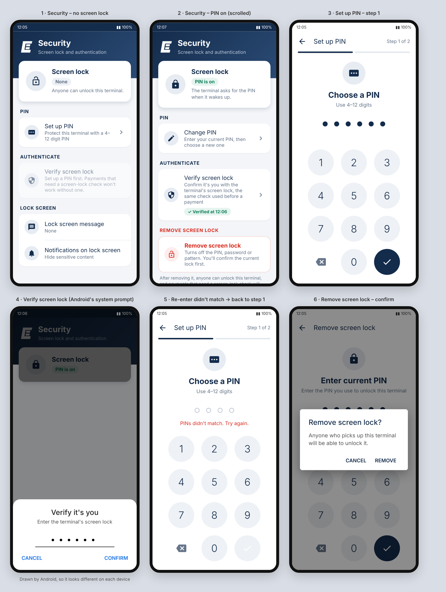

# LockScreenDemo – WizarPOS CloudPOS SDK screen-lock APIs

## Settings-style PIN UI (launcher screen)



Exto branding: navy `#142C4C` + white, Exto "E" in the header and as the launcher icon.

| Section / screen | What it does |
|---|---|
| **Security** settings (`SettingsActivity`) | Navy Exto header + status card (None / PIN is on / Set outside this app) |
| PIN → *Set up PIN* (`PinActivity` SETUP) | Choose a PIN (4–12 digits) → Re-enter PIN → `setPinLock(true, pin)` |
| PIN → *Change PIN* (CHANGE) | Current PIN → new PIN (must differ) → Re-enter → `setPinLock(true, newPin)`; if that fails, remove old then set new |
| **Authenticate** → *Verify screen lock* (`DeviceAuth`) | Android's own screen-lock prompt (BiometricPrompt `DEVICE_CREDENTIAL` on Android 11+, `createConfirmDeviceCredentialIntent` on 7–10), the same check a payment uses; shows "✓ Verified at 12:06" / "✗ Not verified" |
| Lock screen | Lock-screen message, notification policy |
| **Remove screen lock** | PIN set by this app → enter it on the PIN pad → confirm → `setPinLock(false, pin)`. Lock set elsewhere → system prompt → confirm → tries `setPinLock/ setPasswordLock/ setPatternLock(false, "")` until the device is no longer secure |

PIN pad details:
- Dots show progress; the Re-enter step submits as soon as the length matches.
- Wrong or mismatched PIN: dots turn red and shake, plus an error message. A mismatch goes back to step 1.
- 5 wrong current PINs → keypad locked for 30 s with a countdown.
- Long-press ⌫ clears; physical keypad digits / DEL / ENTER work too.
- `FLAG_SECURE` blocks screenshots; SDK calls run in the background with a busy overlay; errors show a "Try again" dialog.

How "current PIN" is checked: the SDK can set a PIN but not read or verify it, so
`PinStore` saves a salted PBKDF2 hash (never the PIN) when this app sets one.
`KeyguardManager.isDeviceSecure()` tells whether any screen lock exists. If a lock was
set outside the app, the status shows "Set outside this app" and the current PIN is
passed to the SDK without being checked locally.

Files: `SettingsActivity.java`, `PinActivity.java`, `PinStore.java`,
`res/layout/activity_settings.xml`, `res/layout/activity_pin.xml`, `res/values/themes.xml`,
`res/values/colors.xml`, `res/values*/dimens.xml` (smaller keypad on short screens),
`res/drawable/*`.

---

## Raw SDK APIs

Demo app for the screen-lock APIs added in **CloudPOS SDK v1.8.3.13**
(`com.cloudpos.advance.ext.system.ISystemDevice`).

| API | What it does | Rule (from the javadoc) |
|---|---|---|
| `setPinLock(boolean enable, String pin)` | Numeric PIN lock | 4 or more digits, numbers only |
| `setPasswordLock(boolean enable, String password)` | Password lock | 4 or more characters, letters and numbers |
| `setPatternLock(boolean enable, String pattern)` | Pattern lock | 4–16 points, digits 1–9, no repeats (`"14789"` = L shape) |
| `setTextOnLockScreen(String)` / `getTextOnLockScreen()` | Text on the lock screen | `""` clears it |
| `setLockScreenShowNotification(int)` / `get…()` | Notifications on the lock screen | 1 = all, 2 = none, 3 = non-sensitive only (default) |

Pattern grid:
```
1 2 3
4 5 6
7 8 9
```

## Setup
1. Copy the CloudPOS SDK library (`cloudpossdkV1.8.3.13*.aar` or `.jar`) into `app/libs/`.
2. Open the project in Android Studio and run it on a WizarPOS terminal.
3. The app declares `android.permission.CREATE_USERS`, which the lock APIs need.
   This is a system-level permission, so the terminal must grant it to your app
   (WizarPOS signs the APK, or its firmware whitelists it). If you see a
   `DeviceException` or `SecurityException`, check this first.

## How to use it in your own app
```java
LockScreenManager lm = new LockScreenManager(context);

// Run on a background thread: ISystemDevice.open() is synchronous.
lm.enableLock(LockScreenManager.LockType.PIN, "1234");
lm.enableLock(LockScreenManager.LockType.PASSWORD, "abcd1234");
lm.enableLock(LockScreenManager.LockType.PATTERN, "14789");

lm.disableLock(LockScreenManager.LockType.PIN, "1234");   // remove the lock

lm.setLockScreenText("ExtoPay terminal #001");
lm.setLockScreenNotification(LockScreenManager.NOTIFICATION_NONE);
```

Calling the SDK directly works like this:
```java
ISystemDevice dev = POSTerminalAdvance.getInstance().getSystemDevice();
dev.open(context);
try {
    dev.setPinLock(true, "1234");
} finally {
    dev.close();
}
```

## Not covered by the javadoc (test on the device)
- **Removing a lock:** the docs don't say what `pin`/`password`/`pattern` must be when
  `enable == false`. The app sends the value typed in the field (the current
  credential); if that fails, try an empty string, or ask WizarPOS.
- **Pattern format:** the parameter is a `String`, but the text describes "an array of
  integers". The app sends the digits as a string such as `"14789"`. If the terminal
  rejects that, ask WizarPOS for the exact format (for example `"1,4,7,8,9"`).
- **Switching lock type** (for example PIN → pattern) without removing the old lock
  first: test whether this works.

## Files
- `app/src/main/java/com/cloudpos/lockscreen/LockScreenManager.java` – SDK wrapper, input checks, open/close
